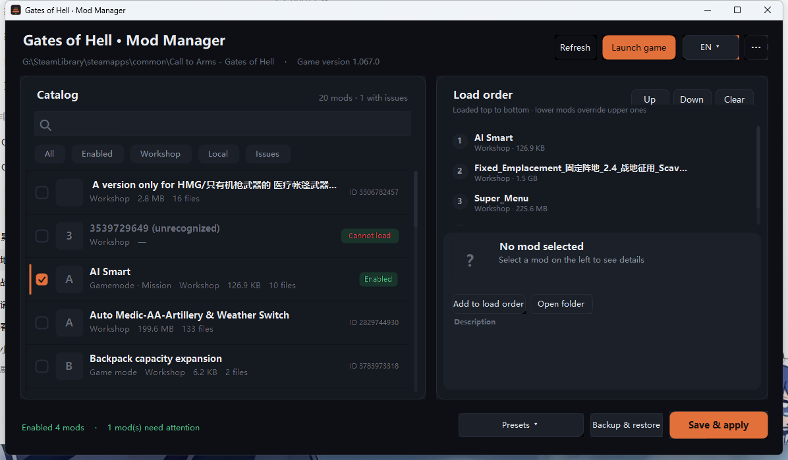

# Gates of Hell · Mod Manager (unofficial)

A lightweight, portable mod manager for **Call to Arms – Gates of Hell** (AppID 400750).
It replaces the discontinued *GoH Mod Manager* and manages the Workshop mods you already
own — load order, presets, share codes, backups, file-conflict checks, 8 UI languages.

> ⚠️ Unofficial fan tool. Not affiliated with Digitalmindsoft or Barbed Wire Studios.



## Why

The game ships with a bare mod list. Once you subscribe to more than a handful of
Workshop mods you need to know **which order they load in** (later mods override earlier
ones), which ones are missing a dependency, and which ones fight over the same file.
The old community manager did that — it was distributed as a Workshop item, and was
removed. This is a standalone replacement: same job, no Workshop dependency.

## Features

- **Load order** — drag to reorder, `Up`/`Down`, `Ctrl+↑/↓`. Order is exactly what the game reads from `options.set`.
- **Dependency check** — reads `require` from `mod.info`, warns about missing/disabled dependencies, offers a one-click fix.
- **File conflicts** — lists every path shipped by more than one enabled mod (only real VFS resources: `resource/`, `localizations/`).
- **Version check** — compares `minGameVersion` / `maxGameVersion` with your game version.
- **Broken mod detection** — empty folders, missing `mod.info` (e.g. half-downloaded Workshop items).
- **Presets** — save a load order ("campaign", "co-op", …) and switch in one click.
- **Share codes** — export the current order (or a preset) as a compact `eJz…` string; a friend pastes it and gets the identical order. Missing mods are listed in a window with one-click Workshop links and a "copy list with links" button.
- **Automatic backups** — every write to `options.set` is backed up first; restore any of the last 40.
- **Author & description** — click a mod to see its Workshop author, subscriber count, last update and description (fetched from Steam's public API, cached offline, falls back to parsing the description).
- **8 languages** — 简体中文, English, 日本語, 한국어, Español, Français, Deutsch, Русский. Picked from your system language on first run, switchable from the top-right button or `Ctrl+L`.

## Requirements

- Windows 10/11 (x64)
- .NET Framework 4.x (built into Windows — nothing to install)
- Steam running, game installed

## Download

- Latest release: <https://github.com/Gastita1/goh-mod-manager/releases/latest>
- Source: <https://github.com/Gastita1/goh-mod-manager>

## Install

1. Download `GoHModManager-v1.0.zip` and extract anywhere (e.g. `F:\GoHModManager`).
2. Run `GoHModManager.exe`. No installer, no registry writes, ~200 KB.

The first launch auto-detects your Steam library, the game folder, the Workshop folder
and your active `options.set`, and imports settings/presets from the old
`%USERPROFILE%\.goh-mod-manager\config.json` if present.

## Usage

| Action | How |
|---|---|
| Enable / disable a mod | click the checkbox or double-click the row |
| Change load order | drag in the right-hand list, or `Ctrl+↑/↓` |
| Save to the game | **Save & apply** (writes `options.set`, backs up first) |
| Switch load order | `Presets ▾` |
| Send your setup to a friend | `Ctrl+E` |
| Receive a setup | `Ctrl+I` |
| Rescan after subscribing | `F5` |
| Change language | top-right button, or `Ctrl+L` |

**Load order rule:** mods are applied top → bottom; the **last** one wins when two mods
ship the same file. If a mod's description says *"place this mod last"*, drag it to the bottom.

## Where things are stored

```
<exe folder>\config\
├─ config.json     settings + presets + language
├─ log.txt         diagnostics
├─ backups\        options.set snapshots (last 40)
└─ cache\          Workshop metadata cache
```

Nothing is written outside the game's `options.set`, this folder, and `%USERPROFILE%`
(only if the exe folder isn't writable).

## FAQ

**The game is running — should I apply?**
Close it first. The game rewrites `options.set` on exit and can undo your changes.
The manager warns you before writing.

**A mod is greyed out / "Cannot load"**
Its folder has no `mod.info` — usually a Workshop item that didn't download fully (or a
non-mod item). Unsubscribe, delete the folder, resubscribe.

**My antivirus complains**
The exe is unsigned. It only reads game folders and writes `options.set` + its own config.
Source is included — build it yourself with `build.cmd` if you prefer.

**Mods don't appear after subscribing**
Press `F5`: the catalogue is scanned at startup.

## Credits

- Inspired by **alexbdka's** *GoH Mod Manager* (the one that disappeared from the Workshop).
- Icons drawn for this project; UI built with plain WinForms, no third-party libraries.
- Game and Workshop content © their respective authors.

## License

MIT — do whatever you want, keep the notice.
